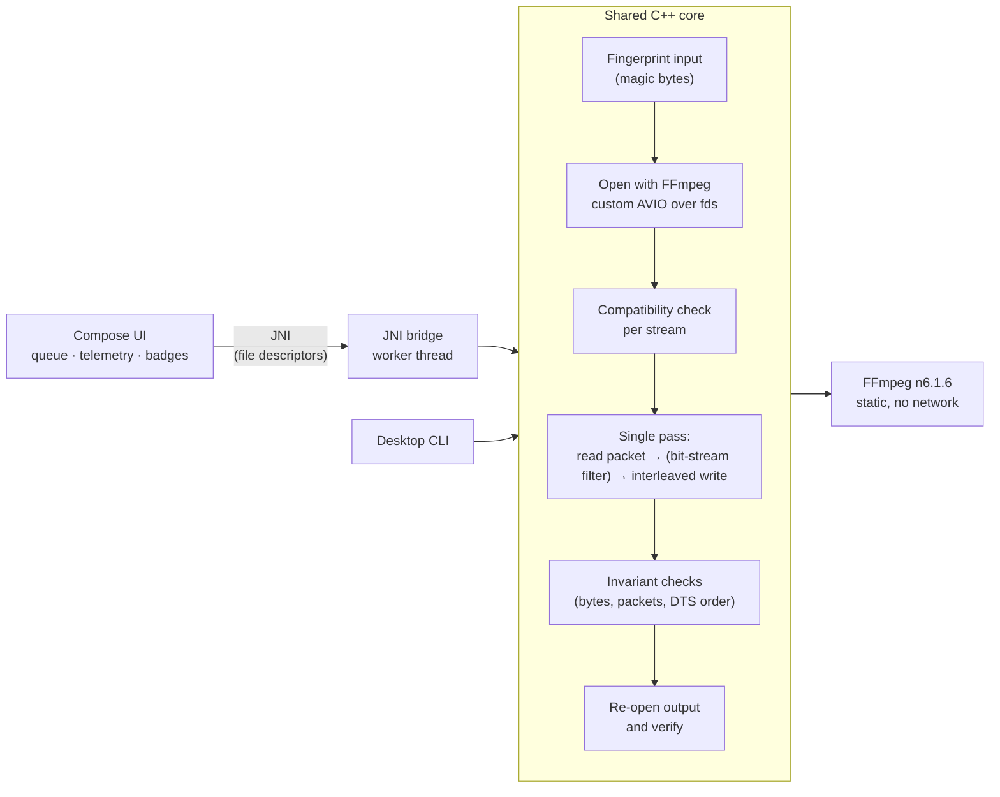

<div align="center">

# MuxNexus

**Your video isn't broken. It's just in the wrong box.**

Re-wrap MP4, MOV and Matroska files in seconds — **no re-encoding, no quality
loss, no internet.** An Android app and a small command-line tool, built on a
network-stripped FFmpeg.

[](https://github.com/VoxNode-ux/MuxNexus/actions/workflows/build.yaml)
[](https://github.com/VoxNode-ux/MuxNexus/actions/workflows/test-native.yaml)
[](https://github.com/VoxNode-ux/MuxNexus/actions/workflows/codeql.yaml)
[](LICENSE)

[Download](#download) · [How it works](#how-it-works) · [Honest status](#honest-status--known-issues) · [Build it](#build-from-source) · [Testing](Testing.md)

</div>

---

## The 30-second pitch

A video file is two things: the **streams** (the actual H.264 video, the AAC
audio) and the **container** that holds them (`.mp4`, `.mkv`, `.mov`).
Players, editors, TVs and phones are often picky about the container while being
perfectly happy with the streams inside.

Converting with a typical "video converter" decodes and re-encodes everything:
slow, lossy, hot phone, drained battery. **Remuxing** just lifts the existing
streams out and writes them into a new container. The pixels and the audio
samples are never touched.

| | Re-encoding | **Remuxing (MuxNexus)** |
|---|---|---|
| Quality | Lossy; every pass degrades | **Identical** — packets are copied |
| Speed | Minutes to hours | **Bounded by disk speed** |
| Battery / heat | High | Low |
| Changes the codec | Yes | No (so some codec/container pairs can't be remuxed; MuxNexus tells you which) |

And because the app never needs the network, it simply **doesn't ask for it**:
`AndroidManifest.xml` has no `INTERNET` permission, and FFmpeg is compiled with
networking removed.

## What you get

- **Lossless container swap** between MP4, QuickTime (MOV) and Matroska (MKV).
- **A batch queue** that survives the app being closed: add files, reorder them,
  remove them, filter by status, and let them run one after another.
- **Compatibility checks before it writes a byte.** Asking for a combination
  that can't work (say TrueHD audio into MP4) gives a clear message and the fix
  ("use Matroska"), not a corrupt file.
- **Output verification.** After writing, the engine re-opens the result and
  checks it; the UI shows a **Verified** or **Not verified** badge per file.
- **A byte-level telemetry viewer** while a job runs: stream index, PTS/DTS,
  byte offset, frame size and keyframe flag of the packet currently moving.
- **Tolerates damaged media.** Isolated unreadable regions are skipped (it only
  gives up after 500 consecutive read errors), so a scratched SD card or flaky
  NAS file usually still yields a result.
- **Cancel anytime**, a hard 4-hour per-job limit so a stuck call can't hang
  forever, and 256 KB buffered I/O straight on file descriptors.
- **Adaptive layouts** (phone, tablet and large-screen two-pane/expanded) and
  light/dark themes, in Jetpack Compose.
- **Merge streams from several files** without re-encoding: swap the audio of
  two videos, add a lossless soundtrack, or keep only the best of several audio
  tracks (command line; see [Merging](#merging-swap-the-audio-keep-the-picture)).
- **A desktop CLI** (Linux, macOS) sharing the exact same engine.

## Download

Grab the files from the [**Releases**](../../releases) page.

### Android

Requires **Android 10 (API 29) or newer**. Releases contain four APKs; pick one:

| File | Use it on |
|------|-----------|
| `…-arm64-v8a-…apk` | Almost every phone and tablet made in the last several years (64-bit ARM) |
| `…-armeabi-v7a-…apk` | Older 32-bit ARM devices |
| `…-x86_64-…apk` | Emulators and some Chromebooks |
| `…-universal-…apk` | Not sure? This one contains all of the above and works everywhere, at the cost of a larger file |

> [!IMPORTANT]
> These are **debug-signed** builds (there is no Play Store release and no
> release keystore yet). Android will ask you to allow installing from your
> browser or file manager. Debug builds are signed with a key generated fresh
> on each CI run, so **you can't update one version over another**: uninstall
> first. See [known issues](#honest-status--known-issues).

### Desktop command line (Linux and macOS)

| File | Platform |
|------|----------|
| `muxnexus-cli-<version>-linux-x86_64.tar.gz` | Linux, 64-bit Intel/AMD |
| `muxnexus-cli-<version>-linux-arm64.tar.gz` | Linux, 64-bit ARM |
| `muxnexus-cli-<version>-macos-arm64.tar.gz` | macOS on Apple silicon |

The release binary has FFmpeg **linked in statically**, so there is nothing else
to install. There is no Intel-Mac and no Windows build yet.

```bash
tar xzf muxnexus-cli-*-linux-x86_64.tar.gz
./muxnexus-cli-*/muxnexus movie.mkv movie.mp4 mp4
```

### Verify what you downloaded

Every release file has a `.sha256` next to it:

```bash
sha256sum -c app-universal-debug.apk.sha256        # Linux
shasum -a 256 -c app-universal-debug.apk.sha256    # macOS
```

Releases are also **attested with GitHub build provenance** — a signed
statement of which commit and workflow produced each file:

```bash
gh attestation verify app-universal-debug.apk --repo VoxNode-ux/MuxNexus
```

(Provenance is only created while the repository is public. If a release has no
attestation, treat it as unattested.)

## Using it

### The Android app

1. Tap **Add your first file** (or the add button), and **choose an output
   format**: MP4, MOV or MKV.
2. Pick the source video with the system file picker, then choose where the new
   file is saved (a name is suggested for you).
3. It joins the queue. Start it and watch progress and telemetry. Reorder or
   remove waiting jobs, or cancel the one that's running.
4. When it finishes, the card shows **Complete** with a **Verified** or
   **Not verified** badge.

Files are accessed through Android's Storage Access Framework, so the app has
**no storage permission** and can only touch files you explicitly pick.

### The CLI

```text
muxnexus <input> <output> <mp4|mov|matroska>
```

```console
$ muxnexus holiday.mkv holiday.mp4 mp4
[REMUXING]  42% ...
[DONE] 100% Complete

Result: Complete
$ echo $?
0
```

Progress goes to stderr (the output above is illustrative). The exit code is `0` on success, `1` if the job
failed, was cancelled, or a file couldn't be opened, and `2` on bad usage.
Warnings and failures about specific streams are printed with a suggested fix:

```text
[WARN] stream#1: Vorbis in MP4 is deprecated and many players reject it. — Use Matroska output instead.
```

`Result: Complete` means the output was written **and** re-read successfully.
`Complete (not verified)` means it was written but the verification pass did not
run (for example the output exceeded the 2 GiB verification limit), and
`Complete (verification warnings)` means it ran and flagged something.

## Merging: swap the audio, keep the picture

Remuxing changes the box. **Merging** takes streams from *several* files and
puts them in one new file, still without re-encoding: the picture of one video
with the sound of another, a lossless soundtrack dropped onto a video that only
had compressed audio, or one file with five audio tracks trimmed down to the
best one. Every packet is copied byte for byte; only its timestamp is adjusted.

> [!NOTE]
> Merging is available in the **command-line tool** today. The Android app does
> not expose it yet (see [Roadmap](#roadmap)).

```bash
# What's in a file, and which audio track is the best?
muxnexus probe movie.mkv
#   #0 video h264 1920x1080
#   #1 audio ac3 6ch 48000Hz 448kbps lossy score=4486
#   #2 audio flac 2ch 48000Hz 24bit lossless score=1001172
#   Best audio: #2 (flac)

# Picture from a.mp4, best audio track from b.mkv:
muxnexus merge out.mkv matroska a.mp4:v b.mkv:best

# Lossless audio file + a video, with the audio delayed by 120 ms:
muxnexus merge out.mkv matroska clip.mp4:v soundtrack.flac:best,d120

# One file, keep the video and only its best audio track:
muxnexus merge out.mkv matroska multi.mkv:v,best
```

(The `probe` output above is illustrative; the numbers depend on your file.)

**Selectors** go after the last `:` of an input, separated by commas. With no
selector an input contributes all of its video and audio (and subtitles when the
output is MKV).

| Selector | Meaning |
|----------|---------|
| `v` / `a` / `s` | all video / audio / subtitle streams (cover art is skipped) |
| `best` | only the highest-quality audio stream |
| `i<N>` | exactly stream number N (see `probe`) |
| `d<ms>` | delay this input by N milliseconds; negative values move it earlier |

**What it does for you**

- **Ranks audio by quality.** Lossless beats lossy; among lossless, higher
  bit depth and sample rate win, then more channels; among lossy, higher bit rate
  wins. DTS counts as lossless only when it is DTS-HD Master Audio.
- **Ends with the video.** If the audio is longer than the video it is trimmed
  to the video's length. If it is shorter by more than a second you get a
  warning that the rest will be silent. (With a single input it behaves like a
  plain remux and never trims.)
- **Lines inputs up on a shared timeline.** Each input starts at zero, plus the
  delay you give it. Packets from all inputs are written in time order.
- **Keeps one default audio track**, whatever the sources said.
- **Checks the result**: the output is re-opened and verified, same as a remux.

**Honest limits**

- "Best" is what the *file claims*. The engine can't listen: a lossless file
  made by converting a lossy source still ranks as lossless, and muxing in a
  better *container* can't improve a recording that was already low quality.
  The gain is real only when the audio you add is genuinely better than the
  audio the video had.
- It does not detect or fix **sync** problems between two different recordings.
  Use `d<ms>` if you know the offset.
- Codec-in-container rules still apply: for example FLAC or TrueHD can't go into
  MP4, so use MKV. Streams the output format can't hold are skipped with an
  explanation.

## What can and can't be converted

**Outputs:** MP4, MOV (QuickTime), Matroska (`.mkv`).

**Inputs** depend on which FFmpeg the engine is built with:

| Build | Can read |
|-------|----------|
| **Android app and the released CLI** (the project's own minimal, pinned FFmpeg) | Containers: MP4 / MOV / M4A, Matroska / WebM, MPEG-TS, MPEG-PS, AVI, FLV, Ogg, ASF (WMV/WMA). Audio files: FLAC, WAV, AIFF, MP3, AC-3, E-AC-3, DTS, DTS-HD, TrueHD, Monkey's Audio, WavPack, CAF, raw ADTS AAC. Raw H.264 and HEVC streams |
| **A CLI you build yourself** against your system FFmpeg | Whatever that FFmpeg can demux (TS, AVI, FLV, Ogg, ...) |

The minimal build is deliberate: every demuxer is code that parses untrusted
files, so only the formats above are compiled in (the list is
`DEMUXERS` in `native-build/build_ffmpeg.sh`). Anything else (RealMedia,
DVD/Blu-ray structures, ...) fails with a clear error. The magic-byte sniffer is
only a first-pass hint; FFmpeg's demuxer has the final say.

**What gets copied:** video (except embedded cover art), audio, and, for MKV
output only, subtitles. Stream metadata and global metadata are kept.
**Not copied:** chapters, attachments, data/timecode tracks, cover art, and
subtitles when writing MP4/MOV.

### Codec / container compatibility

When the output is MP4 or MOV, each stream is checked first:

| Codec | Result |
|-------|--------|
| H.264, AAC, MP3, AC-3, E-AC-3 | Allowed |
| HEVC | Allowed (tagged `hvc1`, passed through an HEVC bitstream filter) |
| AV1, VP9 | Allowed with a note; needs FFmpeg 6.1 or newer |
| Opus, FLAC | Allowed with a note; older players may reject them |
| Vorbis, DTS, raw PCM | **Warning**, with a suggestion to use Matroska |
| TrueHD / MLP, Theora, VP8, SRT/ASS/SSA subtitles | **Rejected**, with a suggestion to use Matroska |
| Anything else | Allowed; the muxer has the final say |

Matroska accepts everything above (text subtitles carry a note that player
support varies).

## How it works



- **Native core** (`native/core/`): the whole remux pipeline in C++17. It reads
  and writes through custom I/O callbacks on raw file descriptors (`pread` /
  `pwrite`), which is what lets it work with Android's SAF descriptors without
  ever needing a file path. Streams are copied packet by packet in a single
  pass. Our code applies only two bitstream filters: `hevc_mp4toannexb` when putting
  HEVC into MP4/MOV, and `aac_adtstoasc` for raw ADTS AAC input.
- **JNI bridge** (`native/android/`): runs each job on its own thread, pins that
  thread to the upper half of the CPU cores as a heuristic for the performance
  cores, and forwards progress and telemetry to Kotlin.
- **Kotlin app** (`app/`): Compose UI, a persistent `BatchQueue`, and a small
  view-model. Every queue write is synchronous so a killed app can't leave a job
  falsely "running" forever.
- **Desktop CLI** (`native/desktop/`): a few dozen lines wrapping the same core.

### Privacy and offline guarantees, and their limits

| Claim | How it's enforced |
|-------|-------------------|
| The app can't use the network | No `INTERNET` or `ACCESS_NETWORK_STATE` permission in the manifest; cleartext traffic disabled |
| FFmpeg can't use the network | Built with `--disable-network --disable-protocols --enable-protocol=file` |
| Nothing is backed up to the cloud | Backups are disabled (`allowBackup="false"`; the backup/extraction rule files are empty) |
| Only files you choose are touched | Storage Access Framework; no storage permissions requested |

You can check the first claim yourself:
`aapt2 dump permissions app-universal-debug.apk` should list no permissions.
These guarantees cover MuxNexus's own code and build; they don't make a
malicious media file harmless. Parsing untrusted files is the real attack
surface, which is why the demuxer and the fingerprinter are fuzzed
(see [Testing.md](Testing.md)).

## Honest status & known issues

MuxNexus is **pre-1.0**. The remux engine is the mature part; the app around it
is younger. Here is what you should know before relying on it:

**Bugs and rough edges we know about**

- **The Android app probably never shows "Verified".** It opens the output file
  write-only, but verification has to read the output back, so the check is
  silently skipped and the badge reads *Not verified*. The CLI and the C++ tests
  open the output read/write and do verify. The fix (open with `"rwt"`, falling
  back to `"w"`) is small and planned.
- **Debug-signed APKs can't be updated in place.** CI generates a new debug key
  each run, so Android treats each release as a different app. Uninstall before
  installing a newer one. A stable release keystore fixes this and is planned.
- **Jobs run one at a time**, not in parallel.

**Limits by design (for now)**

- **The Android app can't merge yet and has no share target.** Both are planned;
  merging works in the command-line tool today.
- It remuxes and merges only. No transcoding, trimming or editing.
- Only the input formats listed above are compiled into the Android build.
- Chapters, attachments, data tracks and cover art are dropped.
- **Resume is groundwork only.** The engine can compute a checkpoint when a job
  is cancelled (off by default, and the app doesn't enable it), but nothing
  consumes it; an interrupted job starts over.
- No Windows or Intel-Mac CLI builds; no 32-bit x86 Android build.

**What hasn't been proven**

- Nothing runs on real Android hardware in CI, and the instrumented UI tests
  are currently switched off. See the full list in
  [Testing.md → What is not tested yet](Testing.md#what-is-not-tested-yet).
- The 16 KB page-size link flag (required for newer Android devices) is set,
  but hasn't been checked on a device.
- Large-file behaviour (multi-GB inputs) hasn't been exercised in tests.

If you hit something that isn't on this list, please
[open an issue](../../issues/new/choose). Include the input's container and
codecs (for example "MKV, H.265 + Opus"); that is nearly always the first thing
needed to reproduce a bug.

## Build from source

### Android app

You need JDK 21, the Android SDK, and NDK **28.2.13676358** with CMake
**3.22.1** (installable through `sdkmanager`). No Android Studio required.

```bash
# 1) Build the static FFmpeg libraries once (10–30 min per ABI).
#    Builds arm64-v8a, armeabi-v7a and x86_64 into app/src/main/cpp/ffmpeg/.
export ANDROID_NDK_HOME="$ANDROID_HOME/ndk/28.2.13676358"
./native-build/build_ffmpeg.sh android

# 2) Build the APKs (debug).
./gradlew :app:assembleDebug
```

Output: `app/build/outputs/apk/debug/` — one APK per ABI plus a universal one.
Install with `adb install` or copy the file to a device. The first Gradle run
downloads Gradle 9.8.2 itself.

The FFmpeg step clones the source **at a pinned commit** and refuses to build if
the commit doesn't match (see `FFMPEG_COMMIT` in `native-build/build_ffmpeg.sh`),
so the exact source behind a binary is known. It enables only what MuxNexus
needs: the demuxers for the input formats listed above; the `mp4`, `mov` and
`matroska` muxers; and three small bitstream filters.

### Desktop CLI

Quick version, against your system FFmpeg (all formats your FFmpeg supports):

```bash
# Debian/Ubuntu: sudo apt install cmake ninja-build pkg-config g++ libavformat-dev libavcodec-dev libavutil-dev
# macOS:         brew install cmake ninja pkg-config ffmpeg
cmake -S native -B build -G Ninja -DCMAKE_BUILD_TYPE=Release
cmake --build build --target muxnexus
./build/muxnexus in.mp4 out.mkv matroska
```

Self-contained version, the way releases are built (project's minimal static
FFmpeg):

```bash
./native-build/build_ffmpeg.sh desktop           # writes build-desktop/
export PKG_CONFIG_PATH="$PWD/build-desktop/lib/pkgconfig"
cmake -S native -B build-cli -G Ninja -DCMAKE_BUILD_TYPE=Release \
      -DMUXNEXUS_BUILD_TESTS=OFF -DPKG_CONFIG_ARGN=--static
cmake --build build-cli --target muxnexus
```

### Run the tests

```bash
./scripts/smoke-test.sh                  # CLI end to end, ~minutes
./gradlew :app:testDebugUnitTest         # Kotlin unit tests
```

The C++ unit, integration and fuzz tests are documented in
[**Testing.md**](Testing.md).

## Supply-chain notes

Because this tool handles untrusted files and ships binaries, the build is
set up to be checkable:

- Every GitHub Action is pinned to a **full commit SHA**, with its version in a
  comment. Dependabot keeps the pins current.
- FFmpeg is built from a **pinned commit**, verified at build time. doctest is
  pinned to a commit as well.
- Release files get **SHA-256 checksums** and, when the repository is public,
  **build provenance attestations**.
- **CodeQL** (Java/Kotlin and C++) runs weekly and on demand.
- Security-relevant Gradle build-tool libraries are held at patched versions.

Not done yet: Gradle dependency hash verification (`verification-metadata.xml`)
and a signed release keystore.

## Project layout

```text
app/                    Android app (Kotlin, Jetpack Compose)
  src/main/java/…/        UI, batch queue, JNI bindings
  src/test/               Kotlin unit tests (Robolectric)
  src/androidTest/        Instrumented UI tests (not run in CI yet)
native/
  core/                   Remux and merge engines, compatibility checks, fingerprinting
  android/                JNI bridge
  desktop/                Command-line tool and its log sinks
  tests/                  C++ unit + integration tests, fixture generator
  fuzz/                   libFuzzer targets
native-build/             Pinned, network-stripped FFmpeg build script
scripts/smoke-test.sh     End-to-end CLI check
.github/workflows/        Build, tests, smoke test, release, CodeQL, nightly
```

## Roadmap

In rough priority order. These are intentions, not promises:

1. Open the Android output read/write so verification actually runs.
2. A stable release keystore, so updates install over each other.
3. **Merge in the Android app** (pick a video and an audio source, choose the
   best audio track), and a **share target** so files can be sent to MuxNexus
   from other apps.
4. Re-enable the instrumented UI tests in CI (emulator).
5. Real resume support built on the existing checkpoint.
6. Optional chapter and attachment preservation.
7. Gradle dependency hash verification.
8. Windows and Intel-Mac CLI builds.

## Contributing

Issues and pull requests are welcome; please read
[CONTRIBUTING.md](CONTRIBUTING.md) first, and keep PRs focused. For security
problems, **don't open a public issue**; follow [SECURITY.md](SECURITY.md).
Everyone is expected to follow the [Code of Conduct](CODE_OF_CONDUCT.md).

## License

MuxNexus's own code is licensed under the [Apache License 2.0](LICENSE).

It statically links [FFmpeg](https://ffmpeg.org/), built from source in an
LGPL-2.1-or-later configuration (no `--enable-gpl`, no non-free components).
The exact FFmpeg source is the pinned commit in `native-build/build_ffmpeg.sh`,
and the build script is in this repository. If you redistribute binaries, make
sure you meet FFmpeg's LGPL obligations (see
[ffmpeg.org/legal.html](https://ffmpeg.org/legal.html)).

Built with Kotlin, Jetpack Compose, [doctest](https://github.com/doctest/doctest)
and a great deal of [FFmpeg](https://ffmpeg.org/). Thank you to everyone who
maintains them.